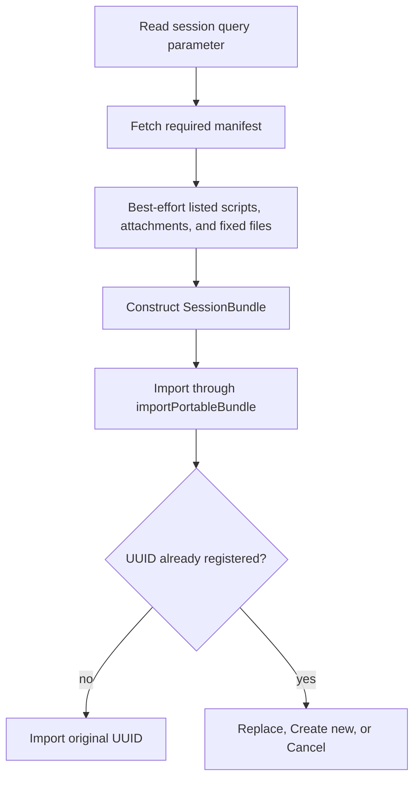

# GitHub Session Publishing

## Goal

Publish DashQL sessions as ordinary, reviewable files on public GitHub Pages without requiring a
`.dashql` archive or a DashQL-hosted publishing service.

Authors keep the existing session folder as the source of truth:

```text
dashql-session.json
dashql-catalog-relations.sql
dashql-catalog-functions.sql
scripts/
  01_setup.sql
  02_report.sql
attachments/
  sales.csv
```

GitHub Pages serves these files with wildcard CORS, so `https://dashql.app` can fetch them directly.

## Script And Attachment Lists

Static HTTP servers cannot enumerate `scripts/` or `attachments/`. The session file therefore lists
both folders next to the connections of the session:

```json
{
  "formatVersion": 6,
  "defaultConnectionId": "22bdfa32-…",
  "connections": [
    { "connectionId": "22bdfa32-…", "params": { "…": "…" } },
    { "connectionId": "9f0c6e1a-…", "params": { "…": "…" } }
  ],
  "scripts": [
    { "name": "01_setup.sql", "connectionId": "22bdfa32-…" },
    { "name": "02_report.sql", "connectionId": "9f0c6e1a-…" }
  ],
  "attachments": [{ "name": "sales.csv" }]
}
```

`connections` holds a copy of every connection the scripts use, so the folder stays self-contained.
`defaultConnectionId` names the connection that new scripts use and whose catalog the catalog files
copy. The script list is authoritative for the order of the scripts and for the connection each
script is analyzed and executed with.
File names carry no meaning of their own: a numeric prefix like `01_` is an ordinary part of the
name, and reordering scripts only rewrites the list. The attachment list is kept in natural order.

Every loader reconciles the list with the files it finds:

- Entries without a file are dropped, the first of duplicate entries wins.
- Script files without an entry are appended in natural order and run on the default connection.
- Entries with unsafe names, draft scripts or invalid database ids are dropped; a remote session is
  then reported as incomplete.
- A connection id that the session does not reference falls back to the default connection.

Local folders, `.dashql` archives and remote sessions all carry the lists in `dashql-session.json`.
Sessions of format version 4 kept the script names in a separate `dashql-session-index.json`. The
migration to version 5 moves the order of the index into the script list, assigns every script to the
main database and removes the index. Versions 4 and 5 referenced a `mainDatabase` and
`attachedDatabases`; the migration to version 6 turns them into the connection list with the main
database as the default connection, and the scripts reference the same ids as connections.

Fixed optional files are discovered by convention and are not listed:

- `dashql-catalog-relations.sql`
- `dashql-catalog-functions.sql`
- `scripts/dashql-draft.sql`

## Link And Loading Flow

A published link points DashQL at the authoritative manifest:

```text
https://dashql.app/?session=https%3A%2F%2Fowner.github.io%2Frepository%2Fexample%2Fdashql-session.json
```



The query parameter is consumed before asynchronous loading so a refresh does not repeat an import
or reopen a conflict dialog.

Remote loading accepts public HTTPS URLs ending in `dashql-session.json`. That manifest is the only
required resource. Every listed script and attachment, the catalog files, and the draft are optional.
Unusable entries and unavailable files are skipped, allowing stale lists to degrade gracefully. List
entries are names, not URLs: script and attachment names may not contain separators or traversal
components, and all fetched files remain below the manifest's directory on the same origin.

The downloaded tree becomes an editable local OPFS snapshot. Its metadata records `HTTP` provenance
and the original manifest URL. Later edits do not write back to GitHub Pages.

## UUID Collisions

Remote trees do not have a separate import implementation. After all remote files are read and
validated, the resulting `SessionBundle` enters the same portable import path used by `.dashql`
files and inline ZIP links.

This preserves the existing behavior:

- No conflict: retain the published UUID.
- Create new: allocate a fresh UUID and append ` (copy)` to a non-empty name.
- Replace: stage and verify the complete replacement before mutating the registered session.
- Cancel: make no storage changes.

Both OPFS and registered native sessions participate in the UUID check.

## Bundled DashQL Examples

The Bazel build stages the declared `examples/sessions/` files under Vite's `publicDir`. Vite copies
that tree unchanged into Pages, Electron, and reloc builds at the same root-relative paths. The root
Bazel filegroup controls which files enter the staged public directory and excludes caches and
`.DS_Store` files:

```text
https://dashql.app/static/examples/sessions/<name>/dashql-session.json
```

Local cache directories and `.DS_Store` files are excluded from the build. The example subtree uses
`Cache-Control: no-store, max-age=0` so every open requests its manifest and SQL files again.
Application assets retain their existing cache policy.

`bundled_sessions.ts` is the typed registry of root `dashql-session.json` paths. On the web those
paths resolve against the current HTTP origin; in the packaged app they resolve under
`app://bundle/static/examples/sessions/`. The session files remain separate static resources rather than
being embedded into a JavaScript chunk.

Cloudflare Pages treats a deployment without a root `404.html` as an SPA. A directory-local
`static/404.html` ensures a missing optional session file returns a real 404 instead of the
application HTML.

## GitHub URL Forms

GitHub Pages:

```text
https://owner.github.io/repository/path/dashql-session.json
```

Raw GitHub also works, but the URL must include a branch, tag, or commit:

```text
https://raw.githubusercontent.com/owner/repository/main/path/dashql-session.json
```

Public GitHub Pages and Raw responses currently provide `Access-Control-Allow-Origin: *`. Requests
are simple credential-free `GET`s; DashQL does not send cookies, authorization, or custom headers.
